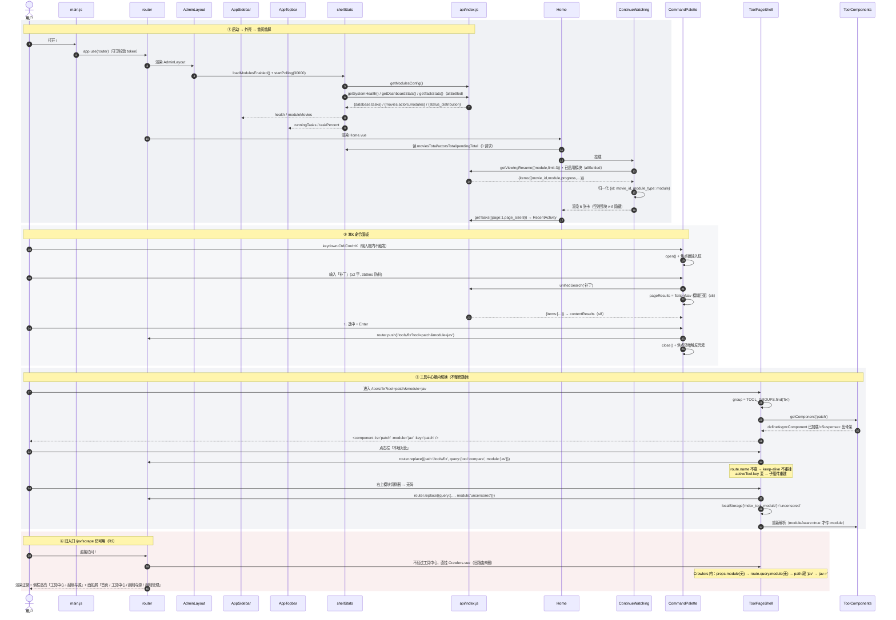
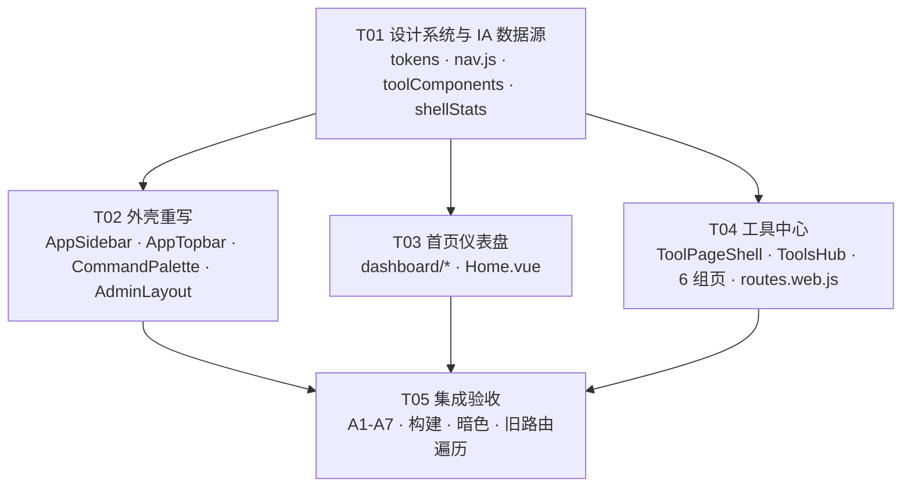

# MDCX 界面重构 Phase 1 · 系统设计与任务分解

> 输入：`docs/redesign/PRD-phase1.md`（v1.0）
> 输出：可直接交给工程师分批实现的实施蓝本
> 版本：v1.0 · 架构师：高见远 · 日期：2026-11-01
> 约束：**不改后端、不删旧路由、不破坏 Electron 逻辑**；构建命令 `node node_modules/vite/bin/vite.js build --config vite.config.web.js`

---

## 0. 事实核查（先读这一节，5 条与 PRD/任务书不符的实际情况）

写代码前我逐文件核对了 PRD 的假设。下面 5 条会直接改变实现方式，**后文设计已按核实结果修正**：

| # | PRD / 任务书的假设 | 代码实际情况 | 影响与处置 |
|---|---|---|---|
| **F1** | 「桌面外壳 `src/views/Layout.vue`，两 shell 共用 `src/`」；P1-6 让 `Layout.vue` 复用 `AppSidebar` | **`src/views/Layout.vue`（2018 行）是死代码，全仓库 0 处引用**。桌面端真实入口是 `src/layouts/CinemaLayout.vue`（228 行，影院竖排 rail + `cinema.css` 暗色体系），见 `routes.desktop.js:7,18` | 本轮**不碰 `Layout.vue`**（碰了等于给死代码做重构）。`AppSidebar/AppTopbar` 只被 `AdminLayout.vue` 引用 → 桌面构建的依赖图里根本不会有它们，**Electron 零风险**。P1-6 的正确目标是 `CinemaLayout.vue`，且它是另一套视觉范式（消费型播放器），建议**不做** |
| **F2** | 3 处需要加 `route.query.module` 兜底：`Crawlers.vue:216`、`Patch.vue:276`、`CompareActors.vue:449` | `Patch.vue:274` 与 `CompareActors.vue:443` **已经有 `props.module` 且 prop 优先**（`if (props.module) return props.module`）。只有 `Crawlers.vue:217-220` 是纯 path 判定、且**没有声明 module prop** | 只需改 `Crawlers.vue` **1 个文件**（加 prop + query 兜底）。`Patch/CompareActors` 由 `ToolPageShell` 传 prop 即生效，**0 改动** |
| **F3** | KPI 取「影片/演员/标签/系列 + 近 7 日增量」；Q2 只说「range=7d 待确认」 | `GET /stats/dashboard` 实际返回 `{movies:{total,completed,pending,failed}, actors:{total}, tasks:{...}, activity:{recent_scraped:0, today_scraped:0}, modules:{mod:{movies,actors}}}` —— **没有 tags、没有 series、`activity.*` 在服务端恒为 0**（`stats.py:44-45,48`，`recent_date` 变量算完没用） | 近 7 日**确认拿不到**，按 Q2 决策删除。KPI 改为 **影片/演员/标签/待刮削** 四项：前两项、第四项都来自 `dashboard`（0 额外请求），标签数用 `getTags({page:1,page_size:1}).total`（1 次轻请求）。**放弃"系列数"**（需再发 `getSeries` 请求，价值低于"待刮削"） |
| **F4** | 「`getStorageStats()` → 存储状态」；`getSystemHealth()` 有 `status` 字段（`Home.vue:191` 就在读 `s.status`） | `GET /stats/storage` 返回的是**元数据完整度**（`images.with_cover/with_poster`、`metadata.with_plot/with_actors`），**不是磁盘容量**。`GET /stats/health` 返回 `{database:{healthy}, tasks:{error_rate,recent_failed}}`，**没有 `status` 字段** —— 这也是现有 `Home.vue` 的"服务器正常"徽章永远显示"未连接"的根因 | `SystemStatusCard` 改为「服务状态 / 元数据完整度 / 版本」三行（数据真实可得）。健康等级在 `shellStats` 里**派生**：请求抛错无 response→`unknown`；`database.healthy===false`→`error`；`tasks.error_rate>0.2`→`warn`；否则 `ok` |
| **F5** | 「新增 8 条 `/tools` 路由」 | PRD §4.2 表格自身只列出 **7 条**（`/tools` + 6 个分组），`/tools/*` 也只有 6 组 | 按 **7 条**实现（1 Hub + 6 组页 = 7 个路由记录、7 个 `.vue` 文件） |

**另外两个会在实现时立刻踩到的点**（详见 §11）：
- `getViewingResume()` 是**按模块**的（后端 `GET /viewing/resume?module=jav` 默认只查 jav，`list_resume(module)` 用 `get_module_session(module)`，传 `'all'` 会炸），**不存在跨模块一次拿全的接口**。
- `getMovieCoverUrl(movie)` 依赖 `movie.module_type`，而 resume 接口返回的字段叫 `module`（不是 `module_type`）→ 直接透传会拼出 JAV 封面地址，无码/FC2 的封面全 404。

---

# Part A · 系统设计

## 1. 实施方案

### 1.1 核心技术难点

| 难点 | 为什么难 | 方案 |
|---|---|---|
| **同一组件被 6 条路由 + 工具中心同时挂载** | `Crawlers.vue` 被 `/jav/scrape` 等 6 条路由引用，现在还要被 `/tools/scrape` 引用。两条路径的模块来源不同（path vs query） | 组件内**兼容两种来源**：`props.module` > `route.query.module` > `route.path` 前缀。旧路径行为完全不变 |
| **`keep-alive` 会缓存工具组页** | `AdminLayout.vue:742` 的 `<keep-alive :max="20" :exclude>` 以 `$route.name` 为 key。组内切工具时 route.name 不变（都是 `ToolsFix`），若动态子组件也被缓存，`Crawlers` 的筛选状态会串到 `Compare` 上 | 组页本身被缓存（切换 `?tool=` 不重挂、不丢滚动）；**动态子组件用 `:key="activeTool.key"` 强制重建**，且明确**不**给子组件包 `keep-alive`。需要保状态的工具自己用 `sessionStorage` |
| **侧栏 5 组展开后必然超高** | 实测：900px 视口下 `900 - 64(topbar) - 56(logo) - 40(bottom) = 740px`。设置组 15 项 × 34px = 510px，媒体库 12 项 = 408px，两组同开会超 | 侧栏改**手风琴（同时只开一组）**，`localStorage` 记忆；设置组列表自身 `overflow:auto`。**A1 验收口径需重述**（见 §17-1） |
| **首屏 4 个数据源是重型聚合，且会被重复请求** | `getDashboardStats()` 要顺序遍历 7 个模块库；现状是 `AdminLayout` 每 30s 调一次，`Home.vue` 挂载时**再调一次** → 打开首页瞬间 2 次全库聚合 | 抽 `stores/shellStats.js` 做**唯一数据源 + 30s 轮询**，侧栏/顶栏/首页 KPI/模块 pill 全部读它。首页不再自己请求 dashboard |
| **构建期路由别名** | `router/index.js` 的 `import { routes } from '@/router/routes'` 被 vite alias 物理替换成 `routes.web.js` / `routes.desktop.js`（`vite.config(.web).js` 的 `resolve.alias`，具体别名必须排在 `@` 之前） | 新增页面只能在 `routes.web.js` 里挂载；新增的 `nav.js`/`toolComponents.js` 走 `@` 别名即可，无需改别名表。**不要**新写 `@/router/routes.js` 之外的入口 |

### 1.2 技术选型与理由

**不引入任何新依赖。** 本轮是结构重组，不是技术升级。

| 选择 | 理由 |
|---|---|
| **侧栏 / 顶栏手写 `<nav>` + `<button>`，不用 `el-menu`** | `el-menu` 的 36px 行高、`is-active` 左侧竖条、折叠态 popup、`unique-opened` 都要靠 `:deep(.el-menu-item)` 覆盖，且它自带 `--el-menu-*` 变量与 `element-overrides.css:161-170` 冲突。手写 120 行 HTML 比覆盖 80 行 CSS 更可控，也才能做到「2px 竖条 + 10% accent 底 + 无阴影」 |
| **`defineAsyncComponent` + `Suspense`** | `Crawlers`(445)/`Patch`(687)/`CompareActors`(1185)/`Import`(916) 都不小，`/tools/organize` 一组 11 个页面若同步引入会一次拉进 ~150kB。分组页 `() => import()` + 组内工具 `defineAsyncComponent` 是两级懒加载 |
| **Pinia store 承载外壳数据** | 项目已是 Pinia（16 个 store）；`shellStats` 天然是单例轮询，用 store 比 provide/inject 更符合现有习惯 |
| **`nav.js` 保持零 `.vue` 引入** | 它会被 `AppSidebar`、`AppTopbar`（面包屑）、`CommandPalette`、`ToolsHub` 四处 import。一旦里面 `import` 了组件，就会把这 4 个 chunk 的依赖图连起来 |
| **状态放 URL（`?module=&tool=`）** | 刷新/分享/书签可复原，且天然避开 `keep-alive` 的状态串味问题；这是 PRD §7.2「URL 即状态」的直接落地 |

### 1.3 架构模式

**分层单向依赖**（不引入新范式，沿用现有 Vue3 `<script setup>` 组合式风格）：

```
config/nav.js      纯数据（IA 真相源）      ← 无人依赖它之外的东西
config/toolComponents.js  组件加载器映射     ← 只 import .vue
stores/shellStats.js      外壳数据单例       ← 依赖 api/
components/shell/*        可复用外壳零件     ← 依赖 config + stores
layouts/AppSidebar|Topbar 外壳装配           ← 依赖 shell + stores
layouts/AdminLayout.vue   布局骨架 + 全局副作用（NSFW/Electron/更新/对话框）
views/*                   页面
```

---

## 2. 文件清单（相对 `G:/MDCX/MDCX-Desktop/`）

### 2.1 新增（27 个）

| 文件 | 职责 | 规模预估 |
|---|---|---|
| `src/config/nav.js` | **IA 单一数据源**：`NAV` 5 组、`MODULES` 7 模块、`TOOL_GROUPS` 6 组 47 工具元数据、`flattenNav()`/`resolveActiveKey()`/`resolveBreadcrumb()`/`findToolByPath()` | 约 380 行（纯数据 + 4 个纯函数） |
| `src/config/toolComponents.js` | `TOOL_COMPONENTS`：`toolKey → defineAsyncComponent`。**唯一**允许 import 工具页的文件 | 约 60 行 |
| `src/stores/shellStats.js` | 外壳数据单例：`health / dashboard / taskStats / version / enabled`，30s 轮询，派生 `moviesTotal/actorsTotal/pendingTotal/runningTasks/taskPercent/moduleMovies` | 约 130 行 |
| `src/styles/tokens.redesign.css` | §12 的全部新增 token（只加不改） | 约 70 行 |
| `src/layouts/AppSidebar.vue` | 侧栏（浅色、手风琴、折叠 64px、底部状态行） | 约 320 行（含样式） |
| `src/layouts/AppTopbar.vue` | 顶栏（折叠按钮 / 面包屑 / ⌘K 入口 / 任务胶囊 / NSFW / 主题 / 用户菜单 / 撤销 Chip） | 约 400 行 |
| `src/components/shell/NavGroup.vue` | 一级组（可折叠）+ 二级项，含折叠动画、选中竖条、计数徽标 | 约 190 行 |
| `src/components/shell/SidebarStatus.vue` | 侧栏底部一行：状态点 + 影片数 + 版本，点击开更新日志 | 约 60 行 |
| `src/components/shell/PageBreadcrumb.vue` | 面包屑（由 `resolveBreadcrumb()` 派生，**取代 120 行 switch 表**） | 约 60 行 |
| `src/components/shell/CommandPalette.vue` | ⌘K 命令面板（页面组 + 内容组 + 最近访问 + 常用工具） | 约 330 行 |
| `src/components/shell/ToolPageShell.vue` | 工具组页通用容器：页头 + 模块切换器 + 左工具列表 + 右动态内容 | 约 250 行 |
| `src/components/shell/ToolCard.vue` | Hub 的 6 张大卡 | 约 80 行 |
| `src/components/dashboard/HeroBanner.vue` | 区块 1：问候 + 状态点 + 3 按钮（**无卡片背景/无渐变**） | 约 110 行 |
| `src/components/dashboard/ContinueWatching.vue` | 区块 2：续播横滑 + 进度条 | 约 150 行 |
| `src/components/dashboard/KpiRow.vue` | 区块 3：4 张 KPI 卡 | 约 120 行 |
| `src/components/dashboard/ModulePills.vue` | 区块 4：7 个模块 pill（一行） | 约 90 行 |
| `src/components/dashboard/QuickActions.vue` | 区块 5：6 个快捷操作 | 约 70 行 |
| `src/components/dashboard/RecentActivity.vue` | 区块 6：最近 8 条任务 | 约 130 行 |
| `src/components/dashboard/SystemStatusCard.vue` | 区块 7：服务/完整度/版本 | 约 90 行 |
| `src/components/dashboard/RecommendStrip.vue` | 区块 8：推荐 3 张 | 约 90 行 |
| `src/views/tools/ToolsHub.vue` | 工具中心首页：6 张大卡（由 `TOOL_GROUPS` 渲染） | 约 90 行 |
| `src/views/tools/ToolsScrape.vue` | `<ToolPageShell group-key="scrape" />` 一行壳 | 约 10 行 |
| `src/views/tools/ToolsFix.vue` | 同上 `fix` | 约 10 行 |
| `src/views/tools/ToolsOrganize.vue` | 同上 `organize` | 约 10 行 |
| `src/views/tools/ToolsHealth.vue` | 同上 `health` | 约 10 行 |
| `src/views/tools/ToolsDownload.vue` | 同上 `download` | 约 10 行 |
| `src/views/tools/ToolsSystem.vue` | 同上 `system` | 约 10 行 |

### 2.2 修改（5 个）

| 文件 | 改什么 | 风险 |
|---|---|---|
| `src/layouts/AdminLayout.vue` | 三段模板手术 + 脚本瘦身（详见 §7.4）。**NSFW / Electron 事件 / 更新器 / 更新日志 / 头像刮削浮层 / undo 全部原样保留** | 中（2075 行，需按 §7.4 的倒序编辑法） |
| `src/views/Home.vue` | 整文件重写为 7 区块编排（不再含 `.module-grid` / `.module-actions` / `hero-card` 渐变） | 低（本就要重写） |
| `src/router/routes.web.js` | **只增不改**：追加 7 条 `/tools*`；`/uncensored` 的 `redirect` 从 `{name:'UncensoredScrape'}` 改为 `/uncensored/movies`。**其余 100+ 条一行不动** | 低 |
| `src/views/Crawlers.vue` | 加 `props.module` + `route.query.module` 兜底（约 6 行） | 低（旧路径行为不变） |
| `src/main.js` | 在 `import './styles/element-overrides.css'` **之后**加 `import './styles/tokens.redesign.css'` | 低 |

> **不需要修改**：`vite.config*.js`（别名表已覆盖）、`router/index.js`、`routes.desktop.js`、`CinemaLayout.vue`、`views/Layout.vue`、`styles/index.css`（新 token 走独立文件，避免污染 1168 行的既有体系）、任何后端文件。

---

## 3. 数据结构与接口

```mermaid
classDiagram
direction TB

%% ---------- config/nav.js（纯数据） ----------
class NavItem {
  +String key
  +String label
  +String icon
  +String to
  +String kind  // 'link' | 'group'
  +Boolean defaultOpen
  +Array~NavItem~ children
  +String countKey      // 'movies' | null
  +String moduleFlag    // 'jav' | null
  +Array~String~ legacy // 旧路径，用于选中态/面包屑
  +String desc
  +Boolean toolEnabled
}

class ModuleDef {
  +String key
  +String label
  +String emoji
  +String movies
  +String actors
  +String flag
  +Boolean toolEnabled
}

class ToolDef {
  +String key
  +String label
  +String tool          // TOOL_COMPONENTS 的键
  +Boolean moduleAware  // 吃 module prop
  +String onlyModule    // 'jav' | null
  +Array~String~ legacy
}

class ToolGroup {
  +String key           // scrape|fix|organize|health|download|system
  +String label
  +String icon
  +String desc
  +String to
  +Array~ToolDef~ tools
}

class NavApi {
  +NAV Array~NavItem~
  +MODULES Array~ModuleDef~
  +TOOL_GROUPS Array~ToolGroup~
  +flattenNav(nav) Array
  +resolveActiveKey(path, query) String
  +resolveBreadcrumb(path, query) Array
  +findToolByPath(path) Object
}

%% ---------- stores/shellStats.js ----------
class ShellStatsStore {
  +String health          // ok|warn|error|unknown
  +Object dashboard
  +Object taskStats
  +String version
  +Object enabled         // {jav:true, ...}
  +Boolean loading
  +Number moviesTotal
  +Number actorsTotal
  +Number pendingTotal
  +Number runningTasks
  +Number taskPercent
  +Object moduleMovies
  +refresh() Promise
  +startPolling(ms) void
  +stopPolling() void
  +loadModulesEnabled() Promise
}

%% ---------- 外壳 ----------
class AppSidebar {
  +Boolean modelValue    // collapsed
  +Object enabled
  +Array openKeys
  +String activeKey
  +toggleGroup(key) void
  +onItemClick(item) void
}

class NavGroup {
  +NavItem item
  +Boolean collapsed
  +Boolean open
  +String activeKey
  +toggle() void
}

class AppTopbar {
  +Boolean collapsed
  +Array breadcrumb
  +emit update:collapsed
  +emit open-search
  +toggleDark() void
  +toggleNsfw() void
  +applyNsfwMode() void
  +logout() void
  +refresh() void
}

class CommandPalette {
  +Boolean modelValue
  +String keyword
  +Array pageResults
  +Array contentResults
  +Array recent
  +Number activeIndex
  +open() void
  +close() void
  +onKeydown(e) void
  +run(item) void
}

class PageBreadcrumb {
  +String path
  +Object query
  +Array trail
}

%% ---------- 工具中心 ----------
class ToolPageShell {
  +String groupKey
  +Object group
  +ToolDef activeTool
  +String currentModule
  +Array moduleOptions
  +Object moduleProps
  +setTool(key) void
  +setModule(key) void
  +normalizeQuery() void
}

class ToolComponents {
  +Object TOOL_COMPONENTS
  +getComponent(toolKey) Component
}

%% ---------- 首页 ----------
class Home {
  +String layout
  +mount() void
}

class ContinueWatching {
  +Array items
  +Boolean loading
  +load() Promise
  +open(item) void
}

class KpiRow {
  +Number tagTotal
  +Array cards
  +load() Promise
}

class ModulePills {
  +Array pills
}

class RecentActivity {
  +Array tasks
  +Boolean loading
  +String error
  +load() Promise
}

class SystemStatusCard {
  +Object health
  +Object coverage
  +String version
  +load() Promise
}

%% ---------- 关系 ----------
NavApi ..> NavItem : 导出
NavApi ..> ModuleDef : 导出
NavApi ..> ToolGroup : 导出
ToolGroup "1" o-- "*" ToolDef : tools

AppSidebar --> NavApi : 读 NAV / 过滤 enabled
AppSidebar *-- NavGroup : 渲染 5 组
AppSidebar *-- SidebarStatus
AppSidebar ..> ShellStatsStore : moduleMovies / health

AppTopbar --> NavApi : resolveBreadcrumb
AppTopbar *-- PageBreadcrumb
AppTopbar ..> ShellStatsStore : runningTasks / version
AppTopbar ..> UndoStore : canUndo

CommandPalette --> NavApi : flattenNav
CommandPalette ..> ToolComponents : 常用工具 6 条
CommandPalette ..> UnifiedSearch : api/modules

ToolPageShell --> NavApi : 查 group
ToolPageShell ..> ToolComponents : getComponent(tool)
ToolPageShell ..> Router : replace(query)

Home *-- ContinueWatching
Home *-- KpiRow
Home *-- ModulePills
Home *-- RecentActivity
Home *-- SystemStatusCard
KpiRow ..> ShellStatsStore
ModulePills ..> ShellStatsStore
SystemStatusCard ..> ShellStatsStore
ContinueWatching ..> API : getViewingResume x N
RecentActivity ..> API : getTasks
```

### 3.1 关键签名（可直接照抄）

```js
// src/config/nav.js —— 零 .vue 依赖
export const MODULES = [
  { key:'jav',        label:'JAV 有码', emoji:'🎬', movies:'/jav/movies',        actors:'/jav/actors',        flag:'jav',        toolEnabled:true  },
  { key:'uncensored', label:'JAV 无码', emoji:'🔓', movies:'/uncensored/movies', actors:'/uncensored/actors', flag:'uncensored', toolEnabled:true  },
  { key:'fc2',        label:'FC2',      emoji:'📹', movies:'/fc2/movies',        actors:'/fc2/actors',        flag:'fc2',        toolEnabled:true  },
  { key:'chinese',    label:'国产',     emoji:'🇨🇳', movies:'/chinese/movies',    actors:'/chinese/actors',    flag:'chinese',    toolEnabled:true  },
  { key:'pornhub',    label:'PORNHub',  emoji:'🌐', movies:'/pornhub/movies',    actors:'/pornhub/actors',    flag:'pornhub',    toolEnabled:true  },
  { key:'western',    label:'欧美',     emoji:'🌍', movies:'/western/movies',    actors:'/western/actors',    flag:'western',    toolEnabled:true  },
  { key:'anime',      label:'里番',     emoji:'📺', movies:'/anime',             actors:null,                 flag:'anime',      toolEnabled:false }, // 无刮削/补丁工具
]

/** @returns {Array<{key,label,to,group,groupLabel,icon,legacy}>} */
export function flattenNav(nav = NAV) {}
/** 当前路径命中的 nav 项 key（含 legacy 旧路径） */
export function resolveActiveKey(path, query = {}) {}
/** @returns {Array<{label,to?}>} 首页 / 工具中心 / 补全与对比 / 补丁刮削 */
export function resolveBreadcrumb(path, query = {}) {}
/** 旧路径 → { groupKey, toolKey }，用于面包屑与"你正在旧入口"提示 */
export function findToolByPath(path) {}
```

```js
// src/config/toolComponents.js
import { defineAsyncComponent } from 'vue'
const lazy = (loader) => defineAsyncComponent({ loader, delay: 120, timeout: 30000, suspensible: false })
export const TOOL_COMPONENTS = {
  crawlers:  lazy(() => import('@/views/Crawlers.vue')),
  patch:     lazy(() => import('@/views/Patch.vue')),
  compareActors: lazy(() => import('@/views/CompareActors.vue')),
  /* … 共 47 个键 … */
}
```

```js
// src/stores/shellStats.js
export const useShellStatsStore = defineStore('shellStats', () => {
  const health = ref('unknown')      // ok|warn|error|unknown
  const dashboard = ref(null)        // /stats/dashboard 原样
  const taskStats = ref(null)        // /stats/tasks 原样
  const version = ref('0.1.0')
  const enabled = ref({})            // /modules/config → {jav:{enabled:true}}
  const loading = ref(false)

  const moviesTotal  = computed(() => dashboard.value?.movies?.total ?? 0)
  const actorsTotal  = computed(() => dashboard.value?.actors?.total ?? 0)
  const pendingTotal = computed(() => dashboard.value?.movies?.pending ?? 0)
  const failedTotal  = computed(() => dashboard.value?.movies?.failed ?? 0)
  const moduleMovies = computed(() => { /* {jav: 1284, ...} */ })
  const runningTasks = computed(() => taskStats.value?.status_distribution?.running ?? 0)
  const taskDone     = computed(() => taskStats.value?.status_distribution?.success ?? 0)
  const taskTotal    = computed(() => Object.values(taskStats.value?.status_distribution || {}).reduce((a,b)=>a+b,0))
  const taskPercent  = computed(() => taskTotal.value ? Math.round(taskDone.value/taskTotal.value*100) : 0)

  async function refresh() {}          // Promise.allSettled([health, dashboard, tasks])
  async function loadModulesEnabled() {}  // getModulesConfig()
  function startPolling(ms = 30000) {}    // 幂等：已启动则 no-op
  function stopPolling() {}
  return { /* … */ }
})
```

> **健康等级派生规则**（修正 F4）：
> ```js
> try { const d = await getSystemHealth()
>   health = d?.database?.healthy === false ? 'error'
>         : (d?.tasks?.error_rate ?? 0) > 0.2 ? 'warn' : 'ok'
> } catch (e) { health = e?.response ? 'error' : 'unknown' }   // 沿用 AdminLayout.vue:1186 的判定
> ```

---

## 4. 程序调用流程



---

## 5. NAV 单一数据源（`src/config/nav.js`）

### 5.1 设计要点

1. **一个文件、四类数据**：`NAV`（侧栏/面包屑/命令面板）、`MODULES`（模块切换器/模块 pill/计数）、`TOOL_GROUPS`（工具中心 Hub/组页/常用工具）、`*` 4 个查询函数。
2. **`icon` 是字符串**，直接用 `<component :is="item.icon" />` —— `main.js:41-43` 已全局注册全部 Element Plus 图标，字符串可解析。
3. **`legacy` 数组**：旧路径归位，用于①侧栏选中态②面包屑③「旧入口」提示。这是「不删旧路由」与「菜单只出现一次」能同时成立的粘合剂。
4. **`moduleFlag`**：值为真时，`enabled[flag] === false` 则整项不渲染（沿用 `AdminLayout.vue:1119-1142` 的逻辑，不新增接口）。
5. **不引入 `order` 字段**：数组顺序即渲染顺序，少一个字段少一处不一致。

### 5.2 完整数据结构（可照抄进 `nav.js`）

```js
/* ===== 5 个一级组 ===== */
export const NAV = [
  { key:'home', label:'首页', icon:'HomeFilled', kind:'link', to:'/' },

  /* ---------- 媒体库：只放"看与管理内容" ---------- */
  {
    key:'library', label:'媒体库', icon:'VideoCamera', kind:'group', defaultOpen:false,
    children:[
      { key:'jav',        label:'JAV 有码', emoji:'🎬', to:'/jav/movies',        countKey:'movies', moduleFlag:'jav',        legacy:['/jav','/jav/browse','/jav/categories','/jav/series','/jav/actors','/jav/studios','/jav/studio-merge','/jav/actor-merge'] },
      { key:'uncensored', label:'JAV 无码', emoji:'🔓', to:'/uncensored/movies', countKey:'movies', moduleFlag:'uncensored', legacy:['/uncensored/categories','/uncensored/series','/uncensored/actors'] },
      { key:'fc2',        label:'FC2',      emoji:'📹', to:'/fc2/movies',        countKey:'movies', moduleFlag:'fc2',        legacy:['/fc2','/fc2/series','/fc2/actors'] },
      { key:'chinese',    label:'国产',     emoji:'🇨🇳', to:'/chinese/movies',    countKey:'movies', moduleFlag:'chinese',    legacy:['/chinese','/chinese/actors'] },
      { key:'pornhub',    label:'PORNHub',  emoji:'🌐', to:'/pornhub/movies',    countKey:'movies', moduleFlag:'pornhub',    legacy:['/pornhub','/pornhub/actors','/pornhub/nationalities'] },
      { key:'western',    label:'欧美',     emoji:'🌍', to:'/western/movies',    countKey:'movies', moduleFlag:'western',    legacy:['/western','/western/actors','/western/config'] },
      { key:'anime',      label:'里番',     emoji:'📺', to:'/anime',             countKey:'movies', moduleFlag:'anime',      legacy:['/anime/series','/anime/favorites'] },
      { divider:true },
      { key:'favorites',  label:'收藏夹',   icon:'Star',      to:'/favorites' },
      { key:'cover-wall', label:'封面墙',   icon:'Grid',      to:'/cover-wall' },
      { key:'playlists',  label:'播放列表', icon:'VideoPlay', to:'/playlists' },
      { key:'queues',     label:'观影队列', icon:'List',      to:'/queues' },
      { key:'actress',    label:'女优收藏', icon:'Avatar',    to:'/actress-collection' },
    ],
  },

  /* ---------- 工具中心：主语是"一次批量动作" ---------- */
  {
    key:'tools', label:'工具中心', icon:'Tools', kind:'group', defaultOpen:false, to:'/tools',
    children:[
      { key:'scrape',   label:'刮削与源',   icon:'Connection',   to:'/tools/scrape',   desc:'刮削、站点优先级、Cookie、刮削复核',
        legacy:['/crawlers','/jav/scrape','/uncensored/scrape','/fc2/scrape','/chinese/scrape','/pornhub/scrape','/western/scrape'] },
      { key:'fix',      label:'补全与对比', icon:'MagicStick',   to:'/tools/fix',      desc:'补丁、本地对比、NFO、多来源精选',
        legacy:['/patch','/jav/patch','/uncensored/patch','/fc2/patch','/chinese/patch','/pornhub/patch','/western/patch',
                '/compare','/jav/compare','/uncensored/compare','/fc2/compare','/pornhub/compare','/western/compare',
                '/compare-actors','/jav/compare-actors','/uncensored/compare-actors'] },
      { key:'organize', label:'整理与入库', icon:'FolderOpened', to:'/tools/organize', desc:'导入、整理、未识别、命名、扫描' },
      { key:'health',   label:'去重与健康', icon:'FirstAidKit',  to:'/tools/health',   desc:'重复番号、指纹、媒体健康、垃圾文件' },
      { key:'download', label:'下载与网盘', icon:'Download',     to:'/tools/download', desc:'下载器、115、CloudDrive2、WebDAV、STRM' },
      { key:'system',   label:'系统与代理', icon:'Monitor',      to:'/tools/system',   desc:'网络诊断、Xray、任务、日志、备份' },
    ],
  },

  /* ---------- 发现：只读、只出结论 ---------- */
  {
    key:'discover', label:'发现', icon:'DataAnalysis', kind:'group', defaultOpen:false,
    children:[
      { key:'top250',   label:'榜单 TOP250',  icon:'Trophy',      to:'/jav/top250' },
      { key:'rec',      label:'智能推荐',     icon:'Promotion',   to:'/recommendations' },
      { key:'stats',    label:'统计总览',     icon:'Histogram',   to:'/stats' },
      { key:'report',   label:'观影报告',     icon:'DataLine',    to:'/viewing-report' },
      { key:'taste',    label:'口味画像',     icon:'IceCream',    to:'/taste' },
      { key:'graph',    label:'影片图谱',     icon:'Share',       to:'/movie-graph' },
      { key:'immerse',  label:'沉浸浏览',     icon:'FullScreen',  to:'/immerse' },
    ],
  },

  /* ---------- 设置：配置型、低频（15 项，需组内滚动，见 §11-1） ---------- */
  {
    key:'settings', label:'设置', icon:'Setting', kind:'group', defaultOpen:false,
    children:[
      { key:'settings',   label:'系统设置',     icon:'Setting',      to:'/settings' },
      { key:'scan',       label:'扫描控制',     icon:'Search',       to:'/scan-control' },
      { key:'modules',    label:'模块管理',     icon:'Grid',         to:'/modules' },
      { key:'themes',     label:'主题外观',     icon:'MagicStick',   to:'/themes' },
      { key:'users',      label:'用户与权限',   icon:'UserFilled',   to:'/users' },
      { key:'plugins',    label:'插件系统',     icon:'Box',          to:'/plugins' },
      { key:'metatube',   label:'Metatube 插件',icon:'Connection',   to:'/metatube-plugin' },
      { key:'emby',       label:'Emby 兼容',    icon:'Connection',   to:'/emby-config' },
      { key:'tvbox',      label:'TVBox',        icon:'VideoCamera',  to:'/tvbox' },
      { key:'mpv',        label:'mpv 设置',     icon:'Monitor',      to:'/mpv-settings' },
      { key:'desktop',    label:'桌面设置',     icon:'Platform',     to:'/desktop-settings' },
      { key:'schema',     label:'Schema 设置',  icon:'Grid',         to:'/schema-settings' },
      { key:'deploy',     label:'部署档位',     icon:'Upload',       to:'/deploy' },
      { key:'telegram',   label:'Telegram Bot', icon:'ChatLineRound',to:'/telegram-bot' },
      { key:'readonly',   label:'唯读来源',     icon:'FolderOpened', to:'/read-only' },
    ],
  },
]
```

### 5.3 `TOOL_GROUPS`（47 个工具，`tool` 即 `TOOL_COMPONENTS` 的键）

> 重复归位原则：**一个组件在工具中心只出现 1 次**。下面已消掉 PRD 自身的 3 处冲突：
> ① `扫描控制` 只在「设置」（它是配置，不是批量动作）；② `STRM` 只在「下载与网盘」（PRD §4.1 与 §7.3 各写一次）；③ `Workflows` 只在「整理与入库」（PRD 已声明）。

```js
export const TOOL_GROUPS = [
  { key:'scrape', label:'刮削与源', icon:'Connection', to:'/tools/scrape', desc:'刮削、站点优先级、Cookie、刮削复核',
    tools:[
      { key:'crawlers',      label:'刮削管理',      tool:'crawlers',      moduleAware:true,  legacy:['/crawlers','/jav/scrape','/uncensored/scrape','/fc2/scrape','/chinese/scrape','/pornhub/scrape','/western/scrape'] },
      { key:'site-priority', label:'站点优先级',    tool:'sitePriority',  legacy:['/site-priority'] },
      { key:'site-registry', label:'站点注册表',    tool:'siteRegistry',  legacy:['/sites'] },
      { key:'cookie-manager',label:'Cookie 管理器', tool:'cookieManager', legacy:['/cookie-manager'] },
      { key:'cookiecloud',   label:'CookieCloud 同步', tool:'cookieCloud', legacy:['/cookiecloud'] },
      { key:'review',        label:'刮削复核',      tool:'review',        legacy:['/review'] },
      { key:'gfriends',      label:'头像库（Gfriends）', tool:'gfriends',  legacy:['/gfriends'] },
    ]},
  { key:'fix', label:'补全与对比', icon:'MagicStick', to:'/tools/fix', desc:'补丁、本地对比、NFO、多来源精选',
    tools:[
      { key:'patch',          label:'补丁刮削',      tool:'patch',         moduleAware:true, legacy:['/patch','/jav/patch','/uncensored/patch','/fc2/patch','/chinese/patch','/pornhub/patch','/western/patch'] },
      { key:'compare',        label:'本地对比',      tool:'compare',       legacy:['/compare','/jav/compare','/uncensored/compare','/fc2/compare','/pornhub/compare','/western/compare'] },
      { key:'compare-actors', label:'对比演员',      tool:'compareActors', moduleAware:true, legacy:['/compare-actors','/jav/compare-actors','/uncensored/compare-actors'] },
      { key:'nfo-scrape',     label:'NFO 免改名刮削',tool:'nfoScrape',     legacy:['/nfo-scrape'] },
      { key:'source-merge',   label:'多来源数据精选',tool:'sourceMerge',   legacy:['/source-merge'] },
      { key:'gap-fill',       label:'缺口体检与补全',tool:'gapFill',       onlyModule:'jav', legacy:['/jav/gap-fill'] },
    ]},
  { key:'organize', label:'整理与入库', icon:'FolderOpened', to:'/tools/organize', desc:'导入、整理、未识别、命名、扫描',
    tools:[
      { key:'import',            label:'批量导入',     tool:'import',           legacy:['/import'] },
      { key:'file-organize',     label:'文件整理',     tool:'fileOrganize',     legacy:['/file-organize'] },
      { key:'auto-organize',     label:'自动整理',     tool:'autoOrganize',     legacy:['/auto-organize'] },
      { key:'unrecognized-files',label:'未识别文件',   tool:'unrecognizedFiles',legacy:['/unrecognized-files'] },
      { key:'refresh-folders',   label:'文件夹刷新',   tool:'refreshFolders',   legacy:['/refresh-folders'] },
      { key:'folder-check',      label:'文件夹归属',   tool:'folderCheck',      legacy:['/jav/folder-check'] },
      { key:'naming-template',   label:'命名模板',     tool:'namingTemplate',   legacy:['/naming-template'] },
      { key:'chinese-name-rules',label:'命名规范（国产）', tool:'chineseNameRules', legacy:['/chinese/name-rules'] },
      { key:'tiers',             label:'分级治理',     tool:'tiers',            legacy:['/tiers'] },
      { key:'workflows',         label:'工作流',       tool:'workflows',        legacy:['/workflows'] },
    ]},
  { key:'health', label:'去重与健康', icon:'FirstAidKit', to:'/tools/health', desc:'重复番号、指纹、媒体健康、垃圾文件',
    tools:[
      { key:'duplicates',    label:'重复番号扫描', tool:'duplicates',    legacy:['/duplicates'] },
      { key:'fingerprint',   label:'指纹去重',     tool:'fingerprint',   legacy:['/fingerprint'] },
      { key:'media-health',  label:'媒体健康扫描', tool:'mediaHealth',   legacy:['/media-health'] },
      { key:'junk-files',    label:'垃圾文件检测', tool:'junkFiles',     legacy:['/junk-files'] },
      { key:'view-status',   label:'三态标记',     tool:'viewStatus',    legacy:['/view-status'] },
      { key:'face-crop',     label:'人脸裁剪',     tool:'faceCrop',      legacy:['/face-crop'],    section:'图像质量' },
      { key:'poster-enhance',label:'海报增强',     tool:'posterEnhance', legacy:['/poster-enhance'],section:'图像质量' },
    ]},
  { key:'download', label:'下载与网盘', icon:'Download', to:'/tools/download', desc:'下载器、115、CloudDrive2、WebDAV、STRM',
    tools:[
      { key:'downloaders',    label:'下载器统一管理', tool:'downloaders',   legacy:['/downloaders'] },
      { key:'download-manager',label:'下载任务',      tool:'downloadManager',legacy:['/download'] },
      { key:'pan-115',        label:'115 网盘',       tool:'pan115',        legacy:['/pan-115'] },
      { key:'cloud-drive2',   label:'CloudDrive2',    tool:'cloudDrive2',   legacy:['/cloud-drive2'] },
      { key:'webdav-import',  label:'WebDAV 导入',    tool:'webdavImport',  legacy:['/webdav-import'] },
      { key:'strm',           label:'STRM 生成',      tool:'strm',          legacy:['/strm'] },
      { key:'quality-goals',  label:'高清版目标',     tool:'qualityGoals',  legacy:['/quality-goals'] },
      { key:'wants',          label:'想要清单',       tool:'wants',         legacy:['/wants'] },
    ]},
  { key:'system', label:'系统与代理', icon:'Monitor', to:'/tools/system', desc:'网络诊断、Xray、任务、日志、备份',
    tools:[
      { key:'network-diag', label:'网络诊断',     tool:'networkDiag', legacy:['/network-diag'] },
      { key:'proxy-xray',   label:'内置 Xray 代理',tool:'proxyXray',  legacy:['/proxy-xray'] },
      { key:'jp-proxy',     label:'日本节点代理', tool:'jpProxy',     legacy:['/proxy/jp'] },
      { key:'system-status',label:'系统状态',     tool:'systemStatus',legacy:['/system-status'] },
      { key:'tasks',        label:'任务管理',     tool:'tasks',       legacy:['/tasks'] },
      { key:'logs',         label:'系统日志',     tool:'logs',        legacy:['/logs'] },
      { key:'log-stream',   label:'实时日志流',   tool:'logStream',   legacy:['/log-stream'] },
      { key:'webhooks',     label:'Webhook 通知', tool:'webhooks',    legacy:['/webhooks'] },
      { key:'backup',       label:'自动备份',     tool:'backup',      legacy:['/backup'] },
    ]},
]
```

> 计数：7 + 6 + 10 + 7 + 8 + 9 = **47 个工具**（PRD §7.3 列 48，差 1 是「扫描控制」已移入设置组）。
> 全站未被工具中心收录的旧页面（`/files`、`/studios`、`/tags`、`/subscriptions`、`/series-subscriptions`、`/jav/code-test`、`/jav/leaderboard`、`/jav/wikipedia`、`/jav/play`、`/onboarding`）**保持原路由可访问、不进侧栏**，通过命令面板搜到（命令面板会兜底搜索全部路由 name）。

---

## 6. 路由变更清单（`src/router/routes.web.js`）

### 6.1 唯一的一处修改（P0-8）

```diff
       {
         path: 'uncensored',
-        redirect: { name: 'UncensoredScrape' }
+        // 2026-11-01 P0-8：进"无码"模块应先看到影片库，而不是刮削页
+        redirect: '/uncensored/movies'
       },
```

### 6.2 追加 7 条（位置：紧跟 `path: ''` 的 Home 记录之后，`routes.web.js:23` 后）

```js
/* ===== 2026-11-01 工具中心（P0-7）· 新增 7 条，旧路由 0 删除（R2） ===== */
{ path: 'tools',           name: 'ToolsHub',      component: () => import('@/views/tools/ToolsHub.vue'),      meta: { title: '工具中心' } },
{ path: 'tools/scrape',    name: 'ToolsScrape',   component: () => import('@/views/tools/ToolsScrape.vue'),   meta: { title: '工具中心 · 刮削与源' } },
{ path: 'tools/fix',       name: 'ToolsFix',      component: () => import('@/views/tools/ToolsFix.vue'),      meta: { title: '工具中心 · 补全与对比' } },
{ path: 'tools/organize',  name: 'ToolsOrganize', component: () => import('@/views/tools/ToolsOrganize.vue'), meta: { title: '工具中心 · 整理与入库' } },
{ path: 'tools/health',    name: 'ToolsHealth',   component: () => import('@/views/tools/ToolsHealth.vue'),   meta: { title: '工具中心 · 去重与健康' } },
{ path: 'tools/download',  name: 'ToolsDownload', component: () => import('@/views/tools/ToolsDownload.vue'), meta: { title: '工具中心 · 下载与网盘' } },
{ path: 'tools/system',    name: 'ToolsSystem',   component: () => import('@/views/tools/ToolsSystem.vue'),   meta: { title: '工具中心 · 系统与代理' } },
```

`component` 映射表（与上文文件清单一致，勿改）：

| path | name | component 文件 |
|---|---|---|
| `/tools` | `ToolsHub` | `src/views/tools/ToolsHub.vue` |
| `/tools/scrape` | `ToolsScrape` | `src/views/tools/ToolsScrape.vue` |
| `/tools/fix` | `ToolsFix` | `src/views/tools/ToolsFix.vue` |
| `/tools/organize` | `ToolsOrganize` | `src/views/tools/ToolsOrganize.vue` |
| `/tools/health` | `ToolsHealth` | `src/views/tools/ToolsHealth.vue` |
| `/tools/download` | `ToolsDownload` | `src/views/tools/ToolsDownload.vue` |
| `/tools/system` | `ToolsSystem` | `src/views/tools/ToolsSystem.vue` |

**name 唯一性已核验**：`routes.web.js` 现有 100+ name 中无任何 `Tools*`（全表已通读）。6 个组页内部一律 `<ToolPageShell group-key="…"/>`，不含业务逻辑。

### 6.3 明确不做的路由动作

- ❌ 不删除、不改写任何现存 path/name（A6：`router.resolve()` 必须全绿）。
- ❌ 不做 P1-1 的 6+6+5+2 条 `redirect` 收敛（Q3 已决策：本轮只 R2）。
- ❌ 不新建 `/discover/*` path（发现组复用现有 path，见 PRD R1）。
- ❌ 不给 `/play/:id`、`/movie/:id` 等详情页加菜单项。

---

## 7. 外壳设计

### 7.1 组件树与职责边界

```
AdminLayout.vue                        ← 只做 4 件事
├── <AppSidebar v-model="collapsed">   ① 装配：Sidebar + (Topbar + main)
├── <el-container>
│   ├── <AppTopbar :collapsed @update:collapsed @open-search>
│   ├── <el-main>  <router-view+keep-alive>  ② 全局对话框（更新/日志/头像浮层）
│   └── （status bar 已删除）
└── <CommandPalette v-model="paletteOpen">
                                       ③ Electron 事件 / NSFW / auth / undo / 版本
                                       ④ 样式：.layout-root / .main-content / 过渡
```

| 关注点 | 归属 | 说明 |
|---|---|---|
| 折叠状态 `collapsed` | `AdminLayout`（`v-model` 下传给两个子组件） | 侧栏宽度与顶栏折叠按钮要同步，放在共同父级 |
| 侧栏展开组 `openKeys` | `AppSidebar` 内部 + `localStorage['mdcx_nav_open']` | 与折叠无关，自己管 |
| NSFW 全部逻辑（6 开关 + 滑杆 + `applyNsfwMode`） | `AppTopbar` | 整体搬移，**一行逻辑都不改**（含 `data-nsfw` 反向映射那段注释） |
| Electron 事件监听（`onNavigateRoute`/`onOpenUrl`/`onTaskControl`/`onUpdaterEvent`） | **留在 `AdminLayout`** | 它是「路由跳转 + 全局任务控制」的宿主，不属于某个零件；搬走会让卸绑逻辑分散 |
| 主题切换 | `AppTopbar`（调 `themeStore.toggleDark()`） | store 是全局的，谁调都行 |
| 更新日志 / 检查更新 / 安装 | `AdminLayout`（对话框）+ `AppTopbar`（入口按钮） | 对话框是 200 行模板，不搬；顶栏只放触发 |
| 健康/统计/任务轮询 | `stores/shellStats.js`（`AdminLayout` 启动与停止） | 见 §10.1 |

### 7.2 `AppSidebar.vue`

**Props / Emits**

| 名称 | 类型 | 说明 |
|---|---|---|
| `modelValue` | `Boolean` | 折叠态（`true` = 64px） |
| `@update:modelValue` | `Boolean` | 由 `AdminLayout` 的 `v-model="collapsed"` 承接 |

**内部状态**：`openKeys:Set<string>`（手风琴，同时只开一个，持久化 `mdcx_nav_open`）、`activeKey = resolveActiveKey(route.path, route.query)`。

**结构**

```vue
<aside class="sidebar" :class="{collapsed}" role="navigation" aria-label="主导航">
  <div class="logo-area">   <!-- 56px：32×32 accent 方块 + MDCX + 副标题 -->
  <nav class="sidebar-menu">        <!-- flex:1; overflow-y:auto -->
    <RouterLink class="nav-item" to="/">首页</RouterLink>
    <NavGroup v-for="g in groups" :key="g.key" :item="g" :collapsed="collapsed"
              :open="openKeys.has(g.key)" :active-key="activeKey"
              @toggle="toggleGroup(g.key)" />
  </nav>
  <SidebarStatus />                  <!-- 40px：● 服务器正常 · 1,234 影片 · v1.0.0 -->
</aside>
```

**关键样式（对应 PRD §5.2，全部落 `tokens.redesign.css` 的变量）**

```css
.sidebar{ width:var(--sidebar-w); background:var(--sidebar-bg); border-right:1px solid var(--border-color);
          transition:width var(--dur-base) var(--ease-out); }        /* 无渐变 */
.sidebar.collapsed{ width:var(--sidebar-w-collapsed); }
.nav-item{ height:var(--nav-item-h); margin:2px 8px; padding-left:12px; border-radius:8px;
           font-size:14px; font-weight:500; color:var(--text-regular);
           transition:background-color var(--dur-fast); }            /* 禁止 transition:all */
.nav-item:hover{ background:var(--hover-layer); }
.nav-item.is-active{ background:color-mix(in srgb, var(--accent) 10%, transparent);
                     color:var(--accent); font-weight:600; position:relative; }
.nav-item.is-active::before{ content:''; position:absolute; left:0; top:8px; bottom:8px;
                     width:2px; border-radius:2px; background:var(--accent); }
```

**验收相关**
- `.sidebar-menu` 必须 `overflow-y:auto`（保底），但折叠态 + 单组展开时 `scrollHeight <= clientHeight`。
- 折叠态二级项用 `el-popover placement="right-start"`（宽 200px）呈现，不给 64px 硬塞。
- 图标 `16px`，文字 `14px/500`，一级 `36px`、二级 `32px`（用 `--nav-item-h` / `--nav-subitem-h`）。

### 7.3 `AppTopbar.vue`

| 名称 | 类型 | 说明 |
|---|---|---|
| `collapsed` | `Boolean` | 控制 Fold/Expand 图标 |
| `breadcrumb` | `Array<{label,to?}>` | 由 `AdminLayout` 用 `resolveBreadcrumb()` 算好传入（或组件内自算，二者择一；**推荐组件内自算**，少一层 props） |
| `@update:collapsed` | — | 折叠按钮 |
| `@open-search` | — | 点搜索框 → `AdminLayout` 打开命令面板 |

**布局（64px，四段 flex）**

```
[⌘ 折叠 32] [面包屑 flex:1]  ……  [搜索 min(420px,32vw) h34] [任务胶囊?] [NSFW] [主题] [用户 ▾]
```

| 元素 | 规格 |
|---|---|
| 搜索入口 | 高 34、圆角 8、底色 `var(--bg-page)`、`⌘K` 徽标 12px；`@click → emit('open-search')`。**不再是 el-dialog，只做触发器** |
| 任务胶囊 | `v-if="shell.runningTasks > 0"`：`⟳ 任务 3/8` + 内嵌 60×4 进度条，点击 `/tasks` |
| NSFW | 原 popover 整体搬入（6 开关 + 滑杆 + 未授权静默回退 localStorage） |
| 主题 | Sunny/Moon，`themeStore.toggleDark()` |
| 撤销 Chip（Q4） | `v-if="undoStore.canUndo"`，24px 高，文案 `可撤销 {{undoStore.undoCount}}`，点击展开 `el-dropdown`（撤销/重做） |
| 用户菜单 | `el-dropdown`：更新日志 / 检查更新(仅 Electron) / 刷新页面 / 退出登录；`updateAvailable` 时头像右上角 6px 红点（替代原独立徽标+两个图标） |
| 删除 | 刷新按钮、退出按钮、更新按钮、安装按钮、`el-divider`、`update-badge` |

`pageTitle` 的 **120 行 switch 表（`AdminLayout.vue:1424-1544`）整段删除**，改由 `PageBreadcrumb` + `nav.js` 派生。

### 7.4 `AdminLayout.vue` 手术方案（**按锚点搜索 + 严格倒序编辑**）

> 2075 行不要重写。**「行区间」只是参考基线，编辑时必须按「锚点」在编辑器里搜索定位**；下方步骤已按**行号从大到小**排序，每步都作用在尚未变动的区域，所以行号始终有效。
> 若你的编辑器支持（VS Code `Ctrl+G` 后选中整行 `Ctrl+Shift+K`），也可直接用行号——但必须**从步骤 1 顺序做到步骤 12**（即行号由大到小）。

| 步 | 锚点（先搜这个） | 参考行区间 | 动作 |
|---|---|---|---|
| 1 | `<style scoped>` 之后的 `.sidebar {` | `1557-2075` | **一次性处理整段样式**：<br>① **删除** `.sidebar/.logo-area/.logo-icon/.logo-text/.menu*/.sidebar-footer/.ver/.header/.header-left/.header-right/.collapse-btn/.breadcrumb/.user-info/.user-avatar/.user-name/.status-bar/.status-left/.status-right/.status-item/.status-progress/.search-result-*/.nsfw-*/.update-badge` 以及 `:global(html.dark) .header/.status-bar/.breadcrumb`；<br>② `.main-content` 的 `padding: 20px` → `padding: var(--content-pad)`（24px，A7 的 24 倍数基准），`background/overflow-y` 不动；<br>③ **保留** `.layout-root/.layout-container/.main-content/.fade-slide*/.fade*/.avatar-scrape-float*/.changelog-*/.update-*/.sr-only` |
| 2 | `const pageTitle = computed(() => {` | `1424-1544` | **整段删除**（120 行 switch 表 + `const titles = {…}`） |
| 3 | `const activeMenu = computed` | `1422` | **删除**（侧栏/面包屑各自从 `nav.js` 派生） |
| 4 | 第二个 `onMounted(async () => {` 内 `getVersion()` | `1404-1409` | **删除**本文件这次请求（版本已在 `shellStats.version`）；删后本文件只留 1 个 `onMounted` |
| 5 | `onBeforeUnmount(() => {` | `1230-1247` | `clearInterval(statusTimer)` 段 → `shellStats.stopPolling()`；**`unbindNavigateRoute/unbindOpenUrl/unbindTaskControl` 三件套逐字保留** |
| 6 | `onMounted(() => {` 内 `loadHealthAndStats()` + `setInterval` | `1214-1228` | 换为 `shellStats.loadModulesEnabled(); shellStats.startPolling()`；`loadNsfwConfig()`→删（迁 `AppTopbar`）；`initUpdater()/initDesktopEvents()/avatarStore.initLibrary()` **保留** |
| 7 | `const healthStatus = ref('unknown')` | `1144-1212` | **整段删除** `healthStatus/stats/taskProgress/healthLevel/healthText/healthIcon/taskPercent/loadHealthAndStats/statusTimer`（迁 `shellStats`） |
| 8 | `const globalSearchVisible = ref(false)` | `980-1010` | **删除** `globalSearch*` 五件套 + `doGlobalSearch/doQuickSearch/goToModuleItem/moduleLabels`（迁 `CommandPalette`） |
| 9 | `<!-- 全局搜索弹窗 -->` | `905-941` | **整块删除** `el-dialog`；在该位置（`</el-container>` 前）加 `<CommandPalette v-model="paletteOpen" />` |
| 10 | `<!-- 底部状态栏：服务器状态 / 任务进度 / 统计信息 -->` | `749-790` | **整块删除** `<el-footer class="status-bar">`（P0-4）。信息已迁 `SidebarStatus` + 任务胶囊 |
| 11 | `<el-header class="header">` | `606-737` | **整块替换**为 `<AppTopbar :collapsed="collapsed" @update:collapsed="collapsed = $event" @open-search="paletteOpen = true" />`。**NSFW popover 模板随之外迁**，`applyNsfwMode/loadNsfwConfig/onNsfwToggle/onNsfwConfigChange` 四个函数与 `nsfw*` 状态一并迁 `AppTopbar` |
| 12 | `<el-aside :width="collapsed ? '64px' : '220px'"` | `6-604` | **整块替换**为 `<AppSidebar v-model="collapsed" />`。整段 `el-menu`（约 270 处菜单相关标记，占原文 1/3）全部消失 |

**编辑完成后 `AdminLayout.vue` 应只剩**：模板 ≈ 60 行（root/container/skip-link/AppSidebar/container/AppTopbar/el-main+keep-alive/CommandPalette/3 个 dialog/头像浮层/sr-only），脚本 ≈ 260 行（Electron、更新器、版本、`formatBytes`、auth 的 `logout`/`refresh`、`excludeCache`），样式 ≈ 130 行。目标 **≈ 450 行**（原 2075 行）。

**必须原样保留（逐字搬移，不改逻辑）**：
`applyNsfwMode()` 的 `data-nsfw` **反向映射**（`enabled=true → data-nsfw="off"`）与 `mdcx-nsfw-change` 事件派发 + `localStorage['mdcx_nsfw']` 兜底、`initUpdater()`/`checkForUpdates`/`downloadUpdate`/`installUpdate`/`openUpdateDialog`、`openChangelog()` 与 `versionInfo`、`initDesktopEvents()` 的三个 `unbind*`、`avatarStore` 浮层模板与 `:global(html.dark)` 暗色覆盖、`excludeCache`（`['MovieDetail','Play','ActorDetail']`）、`liveStatus` 的 `aria-live` 区。

### 7.5 `CommandPalette.vue`

| 能力 | 实现 |
|---|---|
| 触发 | 组件自持 `window.addEventListener('keydown')`：`(e.ctrlKey||e.metaKey) && e.key==='k'` → `preventDefault()+open()`；单独 `/` 仅在 `document.activeElement` 非 `INPUT/TEXTAREA/[contenteditable]` 时触发 |
| 结果组 1 页面 | `flattenNav()` 按 `label` 模糊匹配（大小写无关、支持拼音首字母不强求），≤6 条，显示 `组 / 页名` |
| 结果组 2 内容 | `unifiedSearch(kw)`（`@/api/modules`），kw≥2、350ms 防抖、≤8 条，显示 `模块tag + 标题 + 番号`；跳转 `/{module_name}/movies/{id}`（沿用 `AdminLayout.vue:1007-1010`） |
| 空关键词 | 「最近访问 5 条」(`localStorage['mdcx_cmd_recent']`) + 「常用工具 6 条」（`TOOL_GROUPS`） |
| 键位 | ↑↓ 移动（`aria-activedescendant`）、Enter 执行、Esc 关闭、Tab 不逃逸 |
| 失败 | `unifiedSearch` 抛错 → 静默，只渲染页面组（**不弹 ElMessage**） |
| 无障碍 | `role="dialog" aria-modal="true"`、焦点锁输入框、关闭后焦点还原到 `document.activeElement` 快照 |

---

## 8. 工具中心

### 8.1 `ToolsHub.vue`

```
<PageShell title="工具中心" description="按动作分组，模块在页内切换">
  <div class="hub-grid">                     <!-- repeat(auto-fill,minmax(280px,1fr)); gap:16px -->
    <ToolCard v-for="g in TOOL_GROUPS" :key="g.key" :group="g" :tool-count="g.tools.length" />
  </div>
</PageShell>
```
`ToolCard` props：`group`、`toolCount`、`lastRunAt?`（本轮传 `null`，P1-5 再补）。6 张卡**完全由 `TOOL_GROUPS` 渲染**，禁止硬编码。

### 8.2 `ToolPageShell.vue`（6 个组页共用的唯一实现）

| Props | 类型 | 说明 |
|---|---|---|
| `groupKey` | `String` | `scrape/fix/organize/health/download/system` |

**Computed 契约**

```js
const group        = computed(() => TOOL_GROUPS.find(g => g.key === props.groupKey) || TOOL_GROUPS[0])
const tools        = computed(() => group.value.tools)
const activeTool   = computed(() => tools.value.find(t => t.key === route.query.tool) || tools.value[0])
const currentModule= computed(() => {
  const q = route.query.module
  if (q && MODULES.some(m => m.key === q && m.toolEnabled)) return q
  const saved = localStorage.getItem('mdcx_tool_module')
  if (saved && MODULES.some(m => m.key === saved && m.toolEnabled)) return saved
  return 'jav'
})
const moduleOptions= computed(() => MODULES.filter(m => m.toolEnabled && shell.enabled[m.flag] !== false))
const moduleProps  = computed(() => (activeTool.value.moduleAware ? { module: currentModule.value } : {}))
const blocked      = computed(() => activeTool.value.onlyModule && activeTool.value.onlyModule !== currentModule.value)
```

**方法**

```js
function setTool(key) {           // 只改 ?tool=，不整页跳转
  router.replace({ path: route.path, query: { ...route.query, tool: key } })
}
function setModule(key) {         // 改 ?module= + 持久化
  localStorage.setItem('mdcx_tool_module', key)
  router.replace({ path: route.path, query: { ...route.query, module: key } })
}
function normalizeQuery() {       // 非法 ?tool= / ?module= 归一化，不报错
  const q = { ...route.query, tool: activeTool.value.key, module: currentModule.value }
  if (q.tool !== route.query.tool || q.module !== route.query.module)
    router.replace({ path: route.path, query: q })
}
```

**模板骨架**

```vue
<div class="tool-page">
  <header class="tp-head">
    <div><h1>{{ group.label }}</h1><p>{{ group.desc }}</p></div>
    <el-select v-model="moduleSel" size="small" style="width:160px" placeholder="当前模块">  <!-- 高 32 -->
      <el-option v-for="m in moduleOptions" :key="m.key" :label="`${m.emoji} ${m.label}`" :value="m.key" />
    </el-select>
  </header>
  <div class="tp-body">
    <nav class="tp-list" aria-label="工具列表">
      <button v-for="t in tools" :key="t.key" class="tp-item" :class="{active: t.key===activeTool.key}"
              @click="setTool(t.key)">{{ t.label }}</button>
    </nav>
    <section class="tp-content">
      <EmptyState v-if="blocked" type="no-data"
                  :title="`该工具仅适用于 ${labelOf(activeTool.onlyModule)}`">
        <el-button @click="setModule(activeTool.onlyModule)">切换过去</el-button>
      </EmptyState>
      <Suspense v-else>
        <component :is="getComponent(activeTool.tool)" :key="activeTool.key" v-bind="moduleProps" />
        <template #fallback><div class="tp-skeleton"><Skeleton width="100%" height="240" :rounded="10" /></div></template>
      </Suspense>
    </section>
  </div>
</div>
```

**样式要点**：`.tp-list{width:200px;border-right:1px solid var(--border-color)}`、`.tp-item{height:36px}`、选中态与侧栏同一套（10% accent + 2px 竖条）、`.tp-content{flex:1;min-width:0}`、`.tool-page{display:flex;flex-direction:column;gap:16px}`。
**不加外层 padding**（`el-main` 已有 `--content-pad`），只在外层加 `max-width:var(--content-max); margin-inline:auto`。

### 8.3 6 个组页（全部 10 行以内）

```vue
<!-- src/views/tools/ToolsFix.vue -->
<template><ToolPageShell group-key="fix" /></template>
<script setup>import ToolPageShell from '@/components/shell/ToolPageShell.vue'</script>
```
6 个文件只有 `group-key` 不同。**这是刻意设计**：组页是"路由锚点"，不含逻辑，未来加组只改 `nav.js`。

### 8.4 组件复用表（`toolComponents.js`，键 → 现有文件，**不改内部实现**）

| tool key | 现有文件 | moduleAware |
|---|---|---|
| `crawlers` | `@/views/Crawlers.vue` | ✅（需改，见 §11-2） |
| `patch` | `@/views/Patch.vue` | ✅（已支持 prop） |
| `compareActors` | `@/views/CompareActors.vue` | ✅（已支持 prop） |
| `gapFill` | `@/views/jav/GapFill.vue` | `onlyModule:'jav'` |
| `folderCheck` | `@/views/jav/FolderCheck.vue` | ❌ |
| `chineseNameRules` | `@/views/chinese/NameRules.vue` | ❌ |
| `downloadManager` | `@/views/download/DownloadManager.vue` | ❌ |
| `jpProxy` | `@/views/proxy/JpProxy.vue` | ❌ |
| `siteRegistry` | `@/views/sites/SiteRegistry.vue` | ❌ |
| 其余 38 个 | `@/views/<Name>.vue`（清单见 §5.3） | ❌ |

---

## 9. 首页仪表盘（`src/views/Home.vue` 重写）

### 9.1 编排（12 栅格，`gap:16px`，`max-width:var(--content-max)`）

```vue
<div class="dash">
  <HeroBanner        class="s12" />   <!-- 1 -->
  <ContinueWatching  class="s12" />   <!-- 2  v-if items.length -->
  <KpiRow            class="s12" />   <!-- 3 -->
  <ModulePills       class="s12" />   <!-- 4 -->
  <QuickActions      class="s12" />   <!-- 5 -->
  <div class="row s12">               <!-- 6/7/8 同排 -->
    <RecentActivity   class="c5" />
    <RecommendStrip   class="c4" />
    <SystemStatusCard class="c3" />
  </div>
</div>
```

> **相对 PRD 的 2 处调整（有理由）**：
> ① PRD 写 `RecentActivity 5 / RecommendStrip 5 / SystemStatusCard 2`。实测 1440 宽下内容区 `1440-240-48=1152`，`2/12`≈192px 减去 gap 只剩 ~176px，放 3 行"服务器/存储/版本"会折行。改为 **5/4/3**（SystemStatus 得 ~256px）。
> ② `RecommendStrip` 在 4/12 宽度下放 6 张卡会挤成缩略图，改为 **3 张**（`minmax(110px,1fr)`）。

首屏高度核算（1440×900，`innerHeight 900 - 64 topbar` = 836）：
`Hero 120 + ContinueWatching 300 + KPI 120 + ModulePills 60 + 区块间 3×16 = 48` → **648px < 836**，A3 通过。

### 9.2 各区块数据契约（**全部现有接口，核实过签名**）

| 区块 | 接口（真实签名，`src/api/index.js`） | 返回字段 | 空/错处理 |
|---|---|---|---|
| Hero | `authStore.username`；`shellStats.health` / `moviesTotal` / `actorsTotal` | — | 状态点为灰点 + 「未连接」，**不报错** |
| ContinueWatching | `getViewingResume({ module, limit: 3 })`（`:119`）对**每个已启用模块**并发，`Promise.allSettled` | `{total, items:[{movie_id, module, code, title, cover_url, duration, progress, position, played_at}]}` | 合并后为空 → 整块 `v-if` 隐藏（不占位） |
| KpiRow | `shellStats.dashboard`（0 请求）+ `getTags({page:1,page_size:1})`（`:322`） | dashboard：`movies.total/pending/failed`、`actors.total`；tags：`{items,total}` | 数字 `—` + 12px 灰字「加载失败」 |
| ModulePills | `shellStats.moduleMovies`（来自 `dashboard.modules[key].movies`） | `{jav:{movies,actors},…}` | 为 0 → `等待数据` 灰字 |
| QuickActions | **纯静态** 6 条 | — | — |
| RecentActivity | `getTasks({ page:1, page_size:8 })`（`:498`） | `{items:[{id,name,type,status,progress,created_at}], total}` | `EmptyState type="no-data"` 高 160 + 「批量导入」按钮；错误 → 区块内文案 + 「重试」文字按钮 |
| RecommendStrip | `getRecommendations(12)`（`:1069`） | `{items:[…]}` | 空 → 整块隐藏 |
| SystemStatusCard | `getSystemHealth()`（`:570`）+ `getStorageStats()`（`:569`）+ `shellStats.version` | health：`{database:{healthy},tasks:{error_rate,recent_failed}}`；storage：`{images:{with_cover,with_poster},metadata:{with_plot,with_actors}}` | 显示 `—` + 「去设置」 |

### 9.3 `ContinueWatching` 实现要点（最容易踩坑的组件）

```js
const MODULE_ORDER = ['jav','uncensored','fc2','chinese','pornhub','western','anime']
async function load() {
  const mods = MODULE_ORDER.filter(m => shell.enabled[m] !== false)
  const rs = await Promise.allSettled(mods.map(m => getViewingResume({ module: m, limit: 3 })))
  const merged = rs.flatMap(r => (r.status === 'fulfilled' ? (r.value?.items || []) : []))
    .map(it => ({
      id: it.movie_id,              // ⚠️ resume 返回的是 movie_id，不是 id
      module_type: it.module,       // ⚠️ 必须补这个字段，否则 getMovieCoverUrl 拼成 JAV 封面 → 404
      code: it.code, title: it.title,
      cover_url: it.cover_url,
      progress: it.progress,
    }))
    .sort((a, b) => new Date(b.played_at || 0) - new Date(a.played_at || 0))
    .slice(0, 6)
  items.value = merged
}
const open = (it) => router.push(`/play/${it.id}?module=${it.module_type}`)  // Play.vue:754 读 query.module
const cover = (it) => it.cover_url || getMovieCoverUrl(it)
```
- 卡片 `140×210`（`aspect-ratio:2/3`），底部 2px 进度条 `width: progress*100%`。
- 骨架：6 个 140×210。
- 请求失败全灭 → `items=[]` → 整块隐藏（**不显示错误**，符合 PRD 表格）。
- 可选优化（P2）：`sessionStorage` 缓存 60s，避免"首页 → 详情 → 返回"重复 7 次请求。

### 9.4 明确删除的旧结构

| 删除对象 | 原位置 |
|---|---|
| `.module-grid` 3×3 大卡（含 `linear-gradient` 彩色图标底） | `Home.vue:28-62`、`:163-184`、`:255-269` |
| 每张模块卡的 5 个 `el-button text`（共 30+ 按钮） | `Home.vue:54-60` |
| `hero-card` 深蓝渐变条 | `Home.vue:4-25`、`:247-252` |
| `v-loading` 白遮罩 | `Home.vue:100`（改用骨架屏） |
| `hover: translateY(-3px)` + `box-shadow` 浮起 | `Home.vue:257, 274, 286` |

---

## 10. 数据与状态

### 10.1 `stores/shellStats.js` 是外壳唯一数据源

| 消费者 | 读什么 | 请求数 |
|---|---|---|
| `SidebarStatus` | `health` / `moviesTotal` / `version` | 0 |
| `NavGroup`（媒体库计数） | `moduleMovies[key]` | 0 |
| `AppTopbar`（任务胶囊） | `runningTasks` / `taskDone` / `taskTotal` / `taskPercent` | 0 |
| `Home` → `HeroBanner` / `KpiRow` / `ModulePills` / `SystemStatusCard` | `moviesTotal/actorsTotal/pendingTotal/failedTotal/moduleMovies/version/health` | 0 |
| `CommandPalette` / `ToolPageShell` | `enabled`（模块开关） | 0 |
| **`AdminLayout`** | `startPolling()` / `stopPolling()` / `loadModulesEnabled()` | **3 次 / 30s（全站唯一）** |

> 改造后：打开首页从「AdminLayout 1 次 + Home 1 次 = 2 次全库聚合」降为 **1 次**，且 30s 轮询不变。
> **纪律**：`startPolling()` 只允许 `AdminLayout.onMounted` 调用，子组件**永不**调；`refresh()` 幂等（进行中则复用同一 Promise）。

### 10.2 `?module= & ?tool=` → 页面状态的驱动链

```
URL  /tools/fix?tool=patch&module=uncensored
  │
  ├─ route.path  → groupKey 'fix'  （来自路由表，不是 query）
  ├─ route.query.tool   → activeTool   （非法值 → 回落 tools[0] + router.replace 归一化）
  ├─ route.query.module → currentModule（非法 → localStorage → 'jav' → 归一化）
  │
  ├─ activeTool.moduleAware === true  → v-bind {module: currentModule} → Patch/CompareActors/Crawlers 的 props.module
  └─ activeTool.moduleAware === false → 不传任何 prop（避免属性落到根 DOM 变成 module="jav" 脏属性）
```

**切换只 `router.replace`，不 `push`**（避免把工具切换塞满历史栈，浏览器后退直接回上一页而非上一个工具）。
**模块选择全局记忆**：`localStorage['mdcx_tool_module']`，进任意工具组沿用上次。

### 10.3 现有 hooks 复用清单（不要重写）

| 复用 | 位置 |
|---|---|
| `unifiedSearch()` | `@/api/modules` |
| `getMovieCoverUrl()` / `defaultCover()` | `@/utils/media`（注意 `module_type` 前置条件） |
| `PageShell` | `@/components/base/PageShell.vue`（`title`/`description`/`maxWidth`/`padding`/`gap` + 4 槽） |
| `EmptyState` | `@/components/EmptyState.vue`（`type: no-data/no-results/error/loading`、`inline`、默认槽放 1 个主按钮） |
| `Skeleton` / `SkeletonGrid` | `@/components/Skeleton.vue`（`width/height/rounded/animated`）、`@/components/base/SkeletonGrid.vue` |
| `useThemeStore` / `useAuthStore` / `useUndoStore` / `useAvatarScrapeStore` | `@/stores/*` |

---

## 11. 关键约束与坑

| # | 约束/坑 | 具体处置 |
|---|---|---|
| **1** | **侧栏"全展开无滚动"在 900px 下算术上不可能** | 实测：可用高 `900-64-56-40=740`；设置组 15 项 ×34=510，媒体库 12 项 ×34=408，两组同开 918 > 740。**方案**：手风琴（同时只开一组）+ 设置组列表 `max-height:calc(100vh - 340px); overflow-y:auto`。此时 `.sidebar-menu` 自身 `scrollHeight === clientHeight`（A1 的检测式通过），只是设置组内部滚动。**A1 口径需重述，见 §17-1** |
| **2** | `Crawlers.vue` **没有 `module` prop**，纯 path 判定；`ToolPageShell` 传 `:module` 会落到根元素变成脏 DOM 属性 | 改 `Crawlers.vue:202-221` 处（唯一改动点，6 行）：<br>`const props = defineProps({ module: { type:String, default:null } })`<br>`const moduleKey = computed(() => {`<br>`  if (props.module && MODULE_MAP[props.module]) return props.module`<br>`  const q = route.query.module`<br>`  if (q && MODULE_MAP[q]) return q`<br>`  const seg = route.path.split('/')`<br>`  return MODULE_MAP[seg[1]] ? seg[1] : null`<br>`})`<br>旧路径 `/jav/scrape` 行为不变（`seg[1]='jav'`），新路径走 prop |
| **3** | `Patch.vue` / `CompareActors.vue` **已有** `props.module` 且 prop 优先 → **不要重复改**（PRD 说 3 处，实际 1 处） | 仅验证：`Patch.vue:274`、`CompareActors.vue:443` 保持原样 |
| **4** | **`keep-alive` 以 `$route.name` 为 key**（`AdminLayout.vue:742-744`） | 组页 `ToolsFix` 被缓存 → 切 `?tool=` 不重挂（保住滚动与 URL 状态）；动态子组件 `:key="activeTool.key"` 强制重建；**子组件外层严禁再包 `keep-alive`**；需要保状态的工具用 `sessionStorage` 自恢复 |
| **5** | `keep-alive :max="20"` + 6 个组页只会占 6 个槽，不影响现有 20 上限 | 不改 `:max`，不改 `excludeCache` |
| **6** | **hash 路由 + `base:'./'`** | 所有跳转用 `router.push({path, query})`；禁止 `window.open('/tools/fix')` 这类无 hash 的深链（`vite.config.web.js:10-20` 有明确警告，会导致白屏） |
| **7** | **两 shell 不共用**（F1） | `AppSidebar/AppTopbar` 只被 `AdminLayout` import；**不要**去改 `CinemaLayout.vue` 或死文件 `views/Layout.vue` |
| **8** | `--titlebar-h` 由 `TitleBar.vue:102` 运行时写入 `36px`（Electron），Web 下不存在 → `var(--titlebar-h, 0px)` 兜底 | `.layout-root { height: calc(100vh - var(--titlebar-h, 0px)) }` **逐字保留**；不要把高度改成 `100vh` |
| **9** | `--radius-md` 现状是 **12px**（`index.css:1103` 的 v5.0 Peach 覆盖层），**不是 PRD §8.3 假设的 8px** | **禁止**在 `tokens.redesign.css` 里重定义 `--radius-sm/md/lg`（会波及 126 个页面）。只**新增** `--radius-card:10px` 与 `--radius-ctl:8px`，新组件显式引用这两个 |
| **10** | `--focus-ring` 已存在于 `index.css:956`（`0 0 0 2px var(--primary-color)`），值不符合 PRD（缺第二层白环） | `tokens.redesign.css` 后加载会覆盖——只影响使用 `var(--focus-ring)` 的地方（现有代码几乎不用），安全 |
| **11** | `main.js` 引入顺序：`element-plus/dist/index.css` → `index.css` → `element-overrides.css` | 新文件放在**最后**（`element-overrides.css` 之后），否则 Element 覆盖会赢 |
| **12** | 全局注册了**全部** Element Plus 图标（`main.js:41-43`），主包已 1.4MB | 允许 `icon:'HomeFilled'` 字符串；**不要**再逐个 `import` 图标（无用且增大 chunk）。构建告警 `chunk > 500kB` 是既有状态，不处理 |
| **13** | 元素属性透传：给不声明 props 的组件传 `:module` 会渲染成 DOM 属性 | 用 §8.2 的 `moduleProps` 计算属性，只在 `moduleAware === true` 时 `v-bind` |
| **14** | `getViewingResume` 必须传 `module`（后端默认 `jav`，传 `all` 会 `get_module_session('all')` 抛错） | 按模块并发，见 §9.3 |
| **15** | `getMovieCoverUrl` 依赖 `movie.module_type`，resume 返回的是 `module` | 归一化时补 `module_type`，见 §9.3 |
| **16** | `getSystemHealth()` 无 `status` 字段（`Home.vue:191` 现在读的就是 `undefined`） | 用 §3.1 的派生规则，**顺手修掉这个既有 bug** |
| **17** | `getDashboardStats()` 顺序遍历 7 个模块库，可能 300ms~2s | 首页走 store 缓存（首次骨架屏，30s 内复用），**不要**在 `KpiRow` 里再调一次 |
| **18** | `unifiedSearch` 的 `module_name` 是**下划线**风格（`jav_uncensored`），而 `MODULES[].key` 是 `uncensored` | 跳转用原样 `/{module_name}/movies/{id}`（沿用现有逻辑，别做 key 映射） |
| **19** | 所有可点元素必须 `:focus-visible` 可见 | 用 `outline: var(--focus-ring)`；禁止裸写 `outline:none` |
| **20** | 过渡只允许 `background-color/border-color/color/opacity/transform` | 禁止 `transition: all`（现有 `Home.vue:256,273,285` 即反例，重写时消掉） |

---

## 12. design token 增补（`src/styles/tokens.redesign.css`）

**新建文件**，在 `main.js` 的 `import './styles/element-overrides.css'` **之后**追加一行 import。
**原则：只新增、不覆盖既有 token**（唯一例外是 `--focus-ring`，见坑 10）。

```css
/* ============================================================
   MDCX · Phase 1 重构 token 增补（2026-11-01）
   只新增变量，不改 --radius-sm/md/lg、不改 --bg-*/--text-*、不改 index.css。
   加载顺序：index.css → element-overrides.css → 本文件（最后，可覆盖个别旧值）。
   ============================================================ */
:root {
  /* —— PRD §8.6 布局与容器 —— */
  --sidebar-w:           240px;
  --sidebar-w-collapsed: 64px;
  --topbar-h:            64px;
  --content-max:         1440px;
  --content-pad:         24px;
  --content-pad-lg:      32px;
  --statusbar-h:         0px;           /* P0-4：状态栏移除，留位以便将来复用 */

  /* —— 侧栏底色（Q1 决策：浅色 + 1px 右边框，无渐变） —— */
  --sidebar-bg:          #FBFBFC;

  /* —— PRD §8.3 圆角（新增档位；不复用 --radius-md，它是 12px） —— */
  --radius-card:         10px;          /* 所有内容卡 / KPI 卡 / 工具卡 */
  --radius-ctl:          8px;           /* 新外壳的按钮 / 输入框 / 菜单项 / pill */

  /* —— 侧栏行高 —— */
  --nav-item-h:          36px;
  --nav-subitem-h:       32px;
  --nav-indent:          32px;

  /* —— PRD §8.5 交互态 —— */
  --hover-layer:         rgba(15, 18, 26, 0.04);
  --active-layer:        rgba(15, 18, 26, 0.07);
  --focus-ring:          0 0 0 2px var(--bg-card),
                         0 0 0 4px color-mix(in srgb, var(--accent) 45%, transparent);
  --dur-fast:            120ms;         /* hover / 图标变色 */
  --dur-base:            200ms;         /* 展开折叠 / 页面切换 */
  --ease-out-nav:        cubic-bezier(0.16, 1, 0.3, 1);   /* 不改 --ease-out（已存在） */

  /* —— 卡片边框 hover（PRD §8.4：只改边框色，不动位移/阴影） —— */
  --card-border-hover:   color-mix(in srgb, var(--accent) 28%, var(--border-color));
}

html.dark {
  --sidebar-bg:   #0F1115;
  --hover-layer:  rgba(255, 255, 255, 0.06);
  --active-layer: rgba(255, 255, 255, 0.09);
}

/* PRD §8.6：≥1600px 只放大内边距，不改列数 */
@media (min-width: 1600px) {
  :root { --content-pad: var(--content-pad-lg); }
}
```

**落在 `index.css` 的位置说明**：以上变量**不写进 `index.css`**（它已有 1168 行、两套 token 体系叠加，再改会误伤 126 个页面）。新建独立文件是 PRD §8 的原方案（"新文件：`src/styles/tokens.redesign.css`"），也是唯一能把改动面控制在本轮范围的做法。
**`--ease-out` 已存在于 `index.css:152`**，本轮用新名 `--ease-out-nav` 避免任何意外覆盖；新组件里写 `var(--ease-out-nav, var(--ease-out))`。

---

# Part B · 任务分解

## 13. 依赖包

**无新增依赖。** 全部使用 `package.json` 现有：

```
- vue@^3.5.13                    已有：组件 / defineAsyncComponent / Suspense
- vue-router@^4.5.0              已有：hash 路由、query 驱动
- pinia@^2.3.0                   已有：shellStats store
- element-plus@^2.9.1            已有：el-select / el-popover / el-dropdown / ElMessage / Skeleton 依赖
- @element-plus/icons-vue@^2.3.1 已有：全部图标已全局注册
- @tanstack/vue-query@^5.104.5   已有（本轮不使用，避免与 store 轮询重复）
```

## 14. 任务列表（5 个任务，硬上限内）

> 全程约束：**不改后端、不删旧路由、不动 `CinemaLayout.vue` / `views/Layout.vue` / `routes.desktop.js`**。
> 每个任务完成后都必须能 `node node_modules/vite/bin/vite.js build --config vite.config.web.js` 构建通过（基线已验证：35s 通过）。

### T01 · 设计系统与 IA 数据源（P0，无依赖，可立即开工）

| 项 | 内容 |
|---|---|
| **目标** | 建立 4 个"零 UI"地基文件，后续三个 UI 任务全部依赖它 |
| **文件** | 新建：`src/styles/tokens.redesign.css`、`src/config/nav.js`、`src/config/toolComponents.js`、`src/stores/shellStats.js`<br>修改：`src/main.js`（末尾加 1 行 import） |
| **要点** | ① `nav.js` 严格按 §5.2/§5.3 抄，**不 import 任何 `.vue`**；② `toolComponents.js` 47 个键全用 `defineAsyncComponent`；③ `shellStats` 的健康等级按 §3.1 派生（不是读 `s.status`）；④ `startPolling` 幂等 |
| **依赖** | 无 |
| **验收** | `nav.js` 导出 `NAV/MODULES/TOOL_GROUPS + 4 函数`，`node -e "import('...')"` 可解析；`tokens.redesign.css` 中 **无** `--radius-md`/`--radius-sm`/`--radius-lg`/`--bg-*`/`--text-*` 的重定义；构建通过；DevTools 里 `getComputedStyle(document.documentElement).getPropertyValue('--sidebar-w')` = `240px` |

### T02 · 外壳重写（P0，依赖 T01）— **与 T03/T04 并行**

| 项 | 内容 |
|---|---|
| **目标** | 侧栏浅色化 + 5 组手风琴 + 顶栏 64px + ⌘K 命令面板 + 状态栏移除 |
| **文件** | 新建：`layouts/AppSidebar.vue`、`layouts/AppTopbar.vue`、`components/shell/NavGroup.vue`、`components/shell/SidebarStatus.vue`、`components/shell/PageBreadcrumb.vue`、`components/shell/CommandPalette.vue`<br>修改：`layouts/AdminLayout.vue`（按 §7.4 的 12 步**按锚点倒序**编辑） |
| **要点** | ① 逐字保留 NSFW / Electron / 更新器 / 头像浮层 / `excludeCache`；② 删 `pageTitle` 120 行表；③ 手风琴 + `mdcx_nav_open`；④ 命令面板自持 keydown；⑤ `el-footer` 整块删除 |
| **依赖** | T01 |
| **验收** | A1（折叠 5 行无滚动；单组展开 `.sidebar-menu` 无滚动）、A2（侧栏搜"刮削/补全/对比"各 1 次）、A5（⌘K→"补丁"→Enter 到 `/tools/fix?tool=patch`）、A6（旧路径全可访问）、Electron 启动无塌陷（若可构建）、暗色截图复查 |

### T03 · 首页仪表盘（P0，依赖 T01）— **与 T02/T04 并行**

| 项 | 内容 |
|---|---|
| **目标** | `Home.vue` 从"模块广告牌"变成"工作台"，7 区块 |
| **文件** | 新建：`components/dashboard/{HeroBanner,ContinueWatching,KpiRow,ModulePills,QuickActions,RecentActivity,RecommendStrip,SystemStatusCard}.vue`<br>修改：`views/Home.vue`（整文件重写） |
| **要点** | ① 删 3×3 大卡 / 30+ 按钮 / 深蓝渐变 / `v-loading` / hover 位移；② 栅格 12 列，末排 5/4/3；③ `ContinueWatching` 归一化 `movie_id → id` + 补 `module_type`；④ KPI/ModulePills 只读 `shellStats`（0 请求） |
| **依赖** | T01 |
| **验收** | A3（1440×900 首屏见 Hero+续播+KPI+Pills，不滚动）、A4（页面内非中性彩色块 ≤3）、A7（三个宽度无横向滚动，卡片左缘对齐 24 倍数）、续播空时整块消失不占位 |

### T04 · 工具中心（P0，依赖 T01）— **与 T02/T03 并行**

| 项 | 内容 |
|---|---|
| **目标** | Hub + 6 组页 + 双切换器 + 旧路由保留 |
| **文件** | 新建：`components/shell/ToolPageShell.vue`、`components/shell/ToolCard.vue`、`views/tools/ToolsHub.vue`、`views/tools/Tools{Scrape,Fix,Organize,Health,Download,System}.vue`<br>修改：`views/Crawlers.vue`（§11-2 的 6 行）、`router/routes.web.js`（+7 条、`/uncensored` redirect 修正） |
| **要点** | ① 组页 10 行以内，逻辑全在 `ToolPageShell`；② `router.replace` 不 `push`；③ `moduleProps` 按 `moduleAware` 决定是否传；④ 非法 query 归一化不报错；⑤ `Crawlers` 加 prop + query 兜底（**`Patch/CompareActors` 不改**） |
| **依赖** | T01 |
| **验收** | 7 条新路由可访问；`/tools/fix?tool=patch&module=uncensored` 刷新后状态复原；切工具不整页跳转、滚动位置保留；`/jav/scrape`、`/uncensored`（→ 影片库）不 404/不白屏；组内 47 个工具逐个可点开不报错 |

### T05 · 集成验收（P0，依赖 T02+T03+T04）

| 项 | 内容 |
|---|---|
| **目标** | 三块拼起来跑通，跑完 PRD 的 A1–A7 自测清单 |
| **文件** | 一般不新增；必要时微调（`AdminLayout.vue` 高度/滚动、`ToolPageShell` 与 `el-main` 的 padding 叠加、`Home.vue` 栅格断点） |
| **要点** | ① 全局扫一遍 `transition: all` 与 `outline: none`；② 检查 `el-main` padding 24 与各页 `PageShell` padding 20 的叠加关系（媒体库页面会变 24+20，需目视确认不恶化）；③ 旧路由脚本遍历；④ 暗色全量截图 |
| **依赖** | T02、T03、T04 |
| **验收** | A1–A7 全绿；`npx vite build --config vite.config.web.js` 通过；`routes.web.js` 每条 path `router.resolve().matched.length > 0`；Electron（若构建）启动正常 |

**并行策略**

```
T01  ──┬── T02 ┐
       ├── T03 ├── T05
       └── T04 ┘
```
`T02/T03/T04` **零文件重叠**（T02 只碰 layouts + shell；T03 只碰 dashboard + Home；T04 只碰 tools + Crawlers + routes.web.js），可三人同时开工，只需都先等 T01 的 `nav.js` 定稿。

## 15. Shared Knowledge（跨任务约定）

```
1. NAV 数据形状由 src/config/nav.js 唯一提供。任何组件不得内置菜单文案/路径字典。
   新增页面 = 改 nav.js 一处；菜单出现两次 = 直接判为实现错误。
2. 工具组件只允许在 src/config/toolComponents.js 里 import，且必须 defineAsyncComponent。
3. 外壳数据（health/dashboard/taskStats/version/enabled）只由 shellStats 提供；
   子组件禁止自己调 getDashboardStats / getSystemHealth / getTaskStats / getModulesConfig。
   startPolling 只在 AdminLayout 调；refresh 幂等。
4. URL 是唯一状态源：模块 = ?module=，工具 = ?tool=；切换用 router.replace。
   localStorage 只存偏好：mdcx_nav_open / mdcx_tool_module / mdcx_cmd_recent / mdcx_nsfw。
5. 间距只用 --space-1..--space-12（4/8/12/16/20/24/32/48）；禁止 13px/18px/22px 散数。
6. 圆角：卡片 --radius-card(10)，控件 --radius-ctl(8)，弹层 --radius-lg(12，既有)。
   禁止把卡片写成 --radius-md（它是 12px）。
7. 卡片静态无阴影、hover 只改边框色(--card-border-hover)；禁止 translateY 浮起。
8. 过渡只写 background-color/border-color/color/opacity/transform + --dur-fast/--dur-base。
9. 错误提示：页面级/区块级用内联文案 + 「重试」（不弹 ElMessage）；操作级才用 ElMessage。
10. 所有数字（计数/KPI/进度/番号）加 font-variant-numeric: tabular-nums。
11. 所有 .vue 用 <script setup>；样式 <style scoped>；跨组件变量只走 CSS 自定义属性。
12. 不改后端、不改 routes.desktop.js、不改 CinemaLayout.vue、不改 views/Layout.vue。
```

## 16. 任务依赖图



---

## 17. 待明确（3 条）

| # | 问题 | 我的默认执行方案（无回复即按此做） |
|---|---|---|
| **1** | **A1 的验收口径要改。** PRD 写"全部展开（含媒体库 7 模块）后侧栏总高 ≤100vh，不出现滚动条"。实测 900px 视口可用 740px，而设置组 15 项（510px）+ 媒体库 12 项（408px）同开必然 918px > 740px，**"全部展开"这个状态在物理上放不下** | 改为**手风琴**（同时只展开一组，与现有 `:unique-opened="true"` 行为一致，用户无感），并对设置组列表加组内滚动。此时 `.sidebar-menu.scrollHeight === clientHeight` 恒成立（PRD 的检测式 A1 照样通过），只是设置组内部滚。若产品坚持"全部展开也不滚"，唯一出路是**把设置组裁到 8 项以内**或改成顶栏下拉——这是菜单取舍，需要产品确认。**我按手风琴实现，同时记录 A1 口径修订** |
| **2** | **"继续观看"要不要跨模块？** 后端 `/viewing/resume` 是**按模块**的（无 `all`），跨模块必须并发 7 个请求（每模块 limit 3）。 | 按**跨模块并发**实现（`Promise.allSettled`，7 个轻查询，索引 group-by，合计通常 <300ms），因为 US-H1 的核心是"上次看一半的片子"而不限定模块。若实测 P95 > 800ms，退化为**只查 `jav` 单模块 + 文案标注**（一个开关常量即可切），不影响其它区块 |
| **3** | **KPI 第四张卡用「待刮削」还是「系列数」？** PRD 写"系列"，但 `dashboard` 无 series，要额外发 `getSeries` 请求；而 `movies.pending`（待刮削）在 dashboard 里**免费且可行动**。 | 用 **待刮削**（副行显示 `失败 N`，>0 时 `--danger`）。理由：首页目标是"打开就知道该干什么"，"待刮削 128"比"系列 42"更能驱动行动，且省一次请求。若产品坚持"系列"，加 1 次 `getSeries({page:1,page_size:1})` 即可，改动只有 `KpiRow.vue` 一处 |
